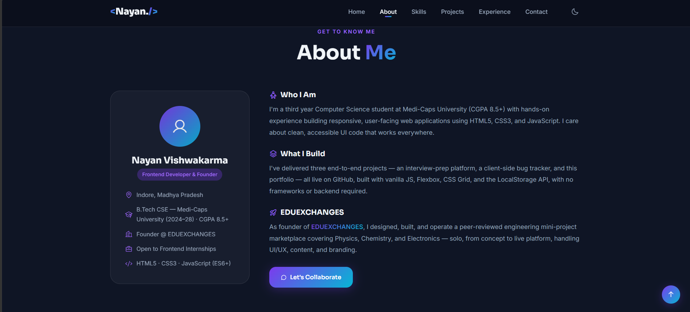

# Personal Portfolio Website 🧑‍💻

My personal developer portfolio — designed and coded from scratch to showcase my projects, skills, and background. Built with pure HTML, CSS, and JavaScript with a focus on clean design and responsiveness.


> *Replace `screenshot.png` with your actual screenshot file*

🔗 **Live:** [nayan2427.github.io/portfolio](https://nayan2427.github.io/portfolio)
> *Update this link once you deploy to GitHub Pages*

---

## Features

- 🧭 Smooth-scroll single-page navigation
- 🎨 CSS keyframe animations on page load
- 📱 Fully responsive — mobile, tablet, and desktop
- 📂 Projects section with links to live repos
- 📬 Contact section with email link
- ♿ Semantic HTML5 for accessibility and SEO

## Tech Stack

| Technology | Usage |
|---|---|
| HTML5 | Semantic structure (header, main, section, footer) |
| CSS3 + Flexbox | Layout, animations, responsive design |
| JavaScript | Smooth scrolling, nav interactions |

## Getting Started

```bash
git clone https://github.com/nayan2427/portfolio.git
cd portfolio
# Open index.html in your browser
```

## Sections

- **Hero** — Introduction and CTA
- **About** — Background and skills summary
- **Projects** — Cards linking to GitHub repos
- **Skills** — Tech stack overview
- **Contact** — Email and social links

## Project Structure

```
portfolio/
├── index.html       # Full single-page structure
├── style.css        # All layout, typography & animations
└── script.js        # Scroll behavior & interactions
```

## Deploy to GitHub Pages (Free Hosting)

1. Go to your repo → **Settings** → **Pages**
2. Set source to `main` branch, `/ (root)`
3. Your site will be live at `https://nayan2427.github.io/portfolio`

## What I Learned

- Writing semantic HTML5 for better accessibility and SEO
- Building smooth CSS animations with `@keyframes`
- Making a layout fully responsive using Flexbox and media queries

---

Made by [Nayan Vishwakarma](https://github.com/nayan2427)
